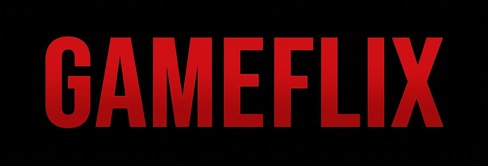

<h1 align="center" style="font-weight: bold;">Titulo do Projeto</h1>

<p align="center">
    
</p>

[JAVASCRIPT__BADGE]: https://img.shields.io/badge/Javascript-000?style=for-the-badge&logo=javascript
[HTML__BADGE]: https://img.shields.io/badge/HTML-%23E34F26.svg?style=for-the-badge&logo=html5&logoColor=white
[CSS__BADGE]: https://img.shields.io/badge/CSS3-%231572B6.svg?style=for-the-badge&logo=css3&logoColor=white
[JQUERY__BADGE]: https://img.shields.io/badge/jQuery-%230769AD.svg?style=for-the-badge&logo=jquery&logoColor=white

<p align="center">
 <a href="#tech">Tecnologias</a> • 
 <a href="#started">Iniciando</a> • 
 <a href="#colab">Colaboradores</a> •
 <a href="#contribute">Contribua</a>
</p>

<p align="center">
     <a href="gameflix-joaovmsdev.netlify.app/">📱 Visite o projeto!</a>
</p>

<p align="center">
    <b>O Gameflix é uma aplicação web front-end inspirada na empresa de streaming Netflix. Nele estão contidas os melhores jogos das maiores desenvolvedoras do mundo.
    Para sua confecção, foram utilizadas as tecnologias HTML, CSS, JavaScript e Bootstrap. Para exibir os jogos foi utilizado o elemento carousel, do bootstrap, permitindo que o usuário possa vizualizar os vários jogos de maniera simples e eficaz, assim como no Netflix.
    O banner inicial apresenta o jogo Grand Theaft Auto, juntamente com um efeito "degradê" preto da esquerada para direita (Deu um trabalhinho para fazer isso)
    </b>
</p>

<h2 id="layout">🎨 Preview</h2>

https://github.com/user-attachments/assets/1135bb60-d9ee-471b-be2b-1ecc7467d3ea

<h2 id="technologies">💻 Tecnologias</h2>

<div>

![javascript][JAVASCRIPT__BADGE]
![HTML][HTML__BADGE]
![jQuery][JQUERY__BADGE]
![CSS][CSS__BADGE]

</div>

<h2 id="started">🚀 Iniciando</h2>

Basta clonar e abrir o index.html

<h3>Pré-requisitos</h3>

- Navegador

<h3>Clonando</h3>

```bash
git clone url-do-seu-projeto-no-github
```

<h2 id="colab">🤝 Colaboradores</h2>

Um agradecimento especial a todas as pessoas que contribuíram para este projeto.

<table>
  <tr>
    <td align="center">
      <a href="#">
        <br>
        <sub>
          <b>João Victor</b>
        </sub>
      </a>
    </td>
  </tr>
</table>

<h2 id="contribute">📫 Contribua</h2>

Contribua da forma que desejar

1. git clone https://github.com/JoaoxVictorMS/gameflix.git
2. Faça as suas contribuições
3. Abra um Pull Request explicando um pouco do que foi feito e aguarde!

<h3>Documentações que podem ajudar</h3>

[📝 Como criar um Pull Request](https://www.atlassian.com/br/git/tutorials/making-a-pull-request)

[💾 Padrão de commit](https://gist.github.com/joshbuchea/6f47e86d2510bce28f8e7f42ae84c716)
